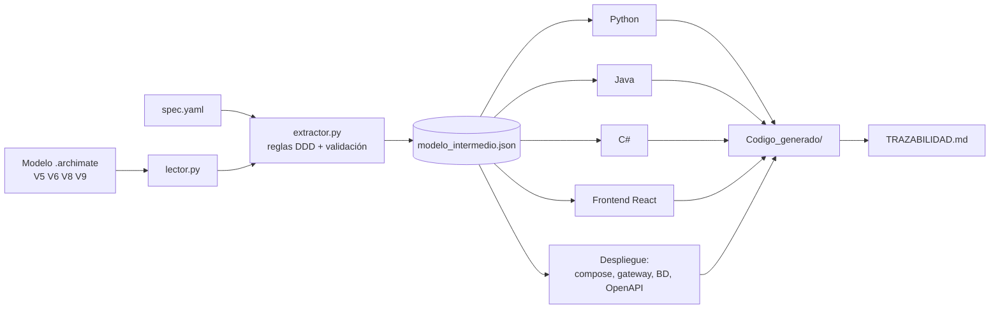

# Arquitectura-Automatizacion-V3 — Del modelo ArchiMate al sistema completo

**Proyecto final de Arquitectura de Software · Opción V3 · Tema 3: Gestión de medicamentos en la farmacia de un hospital**

La opción V3 pide tres cosas:
1. **(V2)** Automatizar la creación del proyecto a partir del diagrama ArchiMate.
2. **(V1)** Completar las capas externas al dominio: base de datos SQL o NoSQL argumentada, caché,
   estados (memento), cifrado simple y despliegue.
3. **(Investigación)** Un cliente web con microfrontends.

Este repositorio cubre las tres. Un solo comando lee el modelo `Modelo_archimate/Modelo_Farmacia_mejorado.archimate`
y el archivo de especificaciones `Automatizacion/spec.yaml`, y genera **todo el sistema**:

```bash
pip install -r Automatizacion/requirements.txt
python Automatizacion/generar.py
```

```
 [OK] Inventario                 D-01 CORE       -> python hexagonal      :8001
 [OK] Vencimientos               D-02 CORE       -> java   microservicios :8002
 [OK] Planificación de Demanda   D-03 SUPPORTING -> python microservicios :8003
 [OK] Abastecimiento             D-04 SUPPORTING -> csharp hexagonal      :8004
 [OK] Seguridad y Auditoría      D-05 GENERIC    -> python microservicios :8005
 [OK] ACL-01 Anticorrupción      6 integraciones -> java   hexagonal      :8010
 [OK] Frontend                   shell + 6 microfrontends -> React + TypeScript + Module Federation :5100

Trazabilidad: 88/88 elementos de la capa de aplicación generaron código (100 %).
```

Y para levantarlo todo:

```bash
cd Codigo_generado && docker compose up --build
# Aplicación web:  http://localhost:5100
# API (gateway):   http://localhost:8080/api/<contexto>/...
```

> 📘 **Para revisar el código**, empiece por [docs/GUIA_DE_REVISION.md](docs/GUIA_DE_REVISION.md): orden de lectura,
> qué hace cada carpeta y preguntas probables de la sustentación.

## Índice
1. [Arquitectura del sistema generado](#1-arquitectura-del-sistema-generado)
2. [Cómo funciona el generador](#2-cómo-funciona-el-generador)
3. [Qué se lee de cada vista](#3-qué-se-lee-de-cada-vista)
4. [Tabla de equivalencias ArchiMate → código](#4-tabla-de-equivalencias-archimate--código)
5. [Especificaciones complementarias (spec.yaml)](#5-especificaciones-complementarias-specyaml)
6. [Backend: decisiones por contexto](#6-backend-decisiones-por-contexto)
7. [Persistencia: SQL y NoSQL](#7-persistencia-sql-y-nosql)
8. [Patrones aplicados](#8-patrones-aplicados)
9. [Microfrontends (investigación)](#9-microfrontends-investigación)
10. [Cómo ejecutar](#10-cómo-ejecutar)
11. [Demostración paso a paso](#11-demostración-paso-a-paso)
12. [Validación del modelo](#12-validación-del-modelo)
13. [Qué se verificó y cómo](#13-qué-se-verificó-y-cómo)
14. [Limitaciones y trabajo futuro](#14-limitaciones-y-trabajo-futuro)
15. [Estructura del repositorio](#15-estructura-del-repositorio)
16. [Fuentes](#16-fuentes)

---

## 1. Arquitectura del sistema generado

```mermaid
flowchart TB
    subgraph Navegador
        SH[Shell :5100<br/>host Module Federation]
        SH --> M1[mf-inventario :5101]
        SH --> M2[mf-vencimientos :5102]
        SH --> M3[mf-planificacion :5103]
        SH --> M4[mf-abastecimiento :5104]
        SH --> M5[mf-seguridad :5105]
        SH --> M6[mf-integraciones :5106]
    end
    M1 & M2 & M3 & M4 & M5 & M6 --> GW[Gateway nginx :8080<br/>/api/&lt;contexto&gt;]
    GW --> INV[Inventario · Python · hexagonal]
    GW --> VEN[Vencimientos · Java · capas]
    GW --> PLA[Planificación · Python · capas]
    GW --> ABA[Abastecimiento · C# · hexagonal]
    GW --> SEG[Seguridad · Python · capas]
    GW --> ACL[ACL-01 · Java · hexagonal]
    INV --> PG[(PostgreSQL)]
    ABA --> PG
    SEG -.-> PG
    VEN --> MG[(MongoDB)]
    PLA --> MG
    ACL -- comandos traducidos --> INV & VEN & PLA
    ABA -- evento Requerimiento Autorizado --> ACL
    ACL -. INT-01..06 .- EXT[Sistemas externos<br/>HCE · Urgencias · ERP · Proveedores · INVIMA · Prog. quirúrgica]
```

- **Un microfrontend por contexto delimitado**, y cada uno habla **solo con su servicio**. No hay frontend que
  dependa de dos dominios.
- **Un servicio por contexto, con su propia base de datos** (*database per service*). Inventario, Abastecimiento
  y Seguridad usan PostgreSQL; Vencimientos y Planificación usan MongoDB.
- **Los sistemas externos solo se tocan a través de la ACL-01.** En la aplicación, el microfrontend
  *Integraciones* hace de "sistema externo" para la demostración.

## 2. Cómo funciona el generador



1. **Lectura** (`archimate/lector.py`): abre el `.archimate` (XML nativo de Archi) y carga los elementos, las
   relaciones y las vistas, incluyendo qué elemento está anidado dentro de cuál.
2. **Interpretación** (`archimate/extractor.py`): aplica reglas DDD sobre vistas concretas y lo cruza con
   `spec.yaml`. Trabaja con los **ID** de los elementos, porque el modelo repite nombres a propósito (hay un
   «Medicamento» por contexto, como corresponde en DDD).
3. **Modelo intermedio** (`modelo_intermedio.json`): lo que la herramienta entendió del diagrama, independiente
   de ArchiMate y del lenguaje.
4. **Generación** (`generadores/` + `plantillas/`): un generador por lenguaje con plantillas Jinja2, más el del
   frontend y el de despliegue.
5. **Trazabilidad**: cada archivo queda asociado al elemento del diagrama que lo originó
   (`Codigo_generado/TRAZABILIDAD.md`).

## 3. Qué se lee de cada vista

| Vista | Qué aporta |
|---|---|
| **V5 Dominios** | Los grupos `D-0X: Título (CORE / SUPPORTING / GENERIC)` dan el dominio y su clasificación; sus *Application Component* y *Function* se vuelven servicios y casos de uso. |
| **V6 Agregados** | En cada *Grouping* `D-0X`: el *Data Object* es la **raíz del agregado**; cada *Application Process* con *Access* al agregado es un **comando**; la relación *Triggering* dice qué **evento** emite. |
| **V8 Mapa de contextos** | Cada *Application Component* es un **contexto** (servicio + microfrontend) o un **sistema externo**; los *Data Object* anidados son sus **entidades**; el **nombre de cada relación** indica el patrón DDD. |
| **V9 Interoperabilidad** | Cada `INT-xx` con *Flow* hacia `ACL-01` es una integración; su objeto de negocio (`OBJ-xx`) es el **DTO** del sistema externo. |

V1 a V4, V7, V10 y V11 justifican el diseño, pero no producen código.

## 4. Tabla de equivalencias ArchiMate → código

| En el modelo | Backend | Frontend |
|---|---|---|
| Contexto (Component en V8) | Servicio con puerto, Dockerfile, README y BD propia | Un microfrontend `mf-<contexto>` |
| Grupo D-0X (V5) | Clasificación del servicio | Insignia CORE / SUPPORTING / GENERIC en el menú |
| Data Object raíz (V6) | Agregado con invariantes, memento y eventos + tabla o colección | Panel con la tabla de instancias |
| Application Process (V6) | Comando + manejador + `POST` | Formulario o botón del comando |
| Application Event (V6) | Evento de dominio publicado en el bus | Mensaje "→ evento «…»" y panel de actividad del shell |
| Data Object anidado (V8) | Entidad del contexto | — |
| Relación *Customer / Supplier* | Puerto + cliente HTTP | Texto "consume a / le sirve a" en el encabezado |
| Relación *Shared Kernel (Lote)* | `shared_kernel` en ambos contextos + JSON Schema | — |
| Relación *Open Host Service* | Contrato OpenAPI publicado | — |
| Relación *ACL* + `INT-xx` (V9) | DTO + traductor en la ACL-01 | Tarjeta del simulador de integraciones |
| Application Component (V5) | Clase de servicio de aplicación | Lista de componentes |
| Application Function (V5) | Caso de uso (responde 501 hasta implementarlo) | Botón "Probar" |

## 5. Especificaciones complementarias (spec.yaml)

ArchiMate dice **qué existe**, pero no en qué lenguaje se implementa, qué base de datos usa ni qué atributos
tiene un agregado. Eso va en `Automatizacion/spec.yaml`:

- Lenguaje, arquitectura y puerto de cada contexto.
- Base de datos (SQL o NoSQL), **con su justificación**.
- **Atributos e invariantes** de cada agregado, tomados del documento de V6 de la entrega 3
  (por ejemplo, *"la cantidad de existencias nunca puede ser negativa"* → `no_negativos: [cantidad]`).
- Efecto de cada comando: `crea`, `restar`, `estado`, `requiere`, `desde_estados`.
- TTL de la caché y campos que se cifran.
- Para cada `INT-xx`: dirección, comando o evento, y el mapeo de campos externo ↔ interno.

**Regla:** el spec no puede inventar elementos. Si nombra algo que no está en el diagrama, el generador se
detiene y dice qué falta. El diagrama manda.

## 6. Backend: decisiones por contexto

| Contexto | Clasif. | Lenguaje | Estilo | BD | Por qué |
|---|---|---|---|---|---|
| Inventario | CORE | Python | Hexagonal | PostgreSQL | Es el corazón del sistema y recibe datos de tres externos (HCE, urgencias, proveedores). Los puertos y adaptadores aíslan el dominio. Necesita ACID: una dispensación no puede dejar existencias negativas. |
| Vencimientos | CORE | Java | Clean | MongoDB | Su lógica es acotada (FEFO, bloqueo) y tiene un solo externo. Las alertas son documentos de vida corta con estructura variable. |
| Planificación de Demanda | SUPPORTING | Python | Clean | MongoDB | Es analítica y su modelo de predicción cambiará. Las estimaciones son documentos versionados. |
| Abastecimiento | SUPPORTING | C# | Hexagonal | PostgreSQL | Se integra con el ERP, que no controlamos. El requerimiento pasa por estados auditables y necesita integridad. |
| Seguridad y Auditoría | GENERIC | Python | Clean | PostgreSQL | Es genérica: a futuro se podría reemplazar por un producto. Expone un *Open Host Service*. |
| ACL-01 | — | Java | Hexagonal | — | Sus "dominios" son los traductores. A un lado están los adaptadores hacia los contextos y al otro los adaptadores hacia los externos. |

La estructura de carpetas sigue la distinción de las diapositivas del curso (*Hexagonal vs Clean*):

| Estilo | Organización | Carpetas generadas |
|---|---|---|
| **Hexagonal** (Cockburn) | **Por lado** | `dominio/` · `puertos/entrada` (comandos y sus manejadores) · `puertos/salida` (repositorios, clientes) · `adaptadores/entrada` (API HTTP) · `adaptadores/salida` (persistencia, clientes HTTP, cifrado) · `contratos/` |
| **Microservicio con Clean Architecture** | **Por capa** | `api/` · `aplicacion/` · `dominio/` · `infraestructura/` · `contratos/` |

`contratos/` es el **lenguaje publicado**: un evento de integración por evento de dominio, con sufijo `V1`
(p. ej. `LoteIngresadoV1`), solo con tipos primitivos y sin depender del dominio. Los eventos salen del
servicio ya traducidos a su contrato. Los dos estilos usan las mismas plantillas; cambiar el estilo de un contexto
es cambiar una línea del spec. Una prueba automática verifica la **regla de dependencias**: el dominio y los
puertos nunca importan adaptadores ni infraestructura.

## 7. Persistencia: SQL y NoSQL

Cada servicio tiene dos adaptadores para el **mismo puerto** `Repositorio<Agregado>`: uno en memoria (desarrollo)
y otro de base de datos real. Se elige con la variable `PERSISTENCIA` (`memoria` o `bd`); en `docker-compose`
está en `bd`.

| | SQL (PostgreSQL) | NoSQL (MongoDB) |
|---|---|---|
| Python | `psycopg` 3 | `pymongo` |
| Java | JDBC (`org.postgresql`) | `mongodb-driver-legacy` |
| C# | `Npgsql` | `MongoDB.Driver` |
| Esquema | El adaptador ejecuta `CREATE TABLE IF NOT EXISTS` al arrancar. Las invariantes también quedan como `NOT NULL` y `CHECK` (`db/esquema.sql`). | Un documento por agregado, con `_id` = id. Validadores de referencia en `db/colecciones.json`. |
| Escritura | *Upsert* por id (`INSERT … ON CONFLICT DO UPDATE`) | `replaceOne` / `findOneAndReplace` con upsert |

Los campos sensibles (por ejemplo, el proveedor) llegan **cifrados** a la base de datos: el adaptador cifra al
guardar y descifra al leer, y el dominio nunca se entera. `bd/postgres/01-crear-bases.sql` crea una base de datos
por contexto la primera vez que arranca PostgreSQL.

## 8. Patrones aplicados

| Patrón | Dónde | Para qué |
|---|---|---|
| Agregado / raíz (DDD) | Clase del agregado | Protege sus invariantes. |
| Comando + manejador | `comandos` | Cada *Application Process* es un caso de uso de escritura. |
| Eventos de dominio + Observer | `BusEventos` | «Requerimiento Autorizado» dispara el envío al ERP sin que el agregado lo sepa. |
| **Memento** | `crear_memento` / `restaurar` + `Caretaker` | Revierte si se viola una invariante; deshacer con `POST /{id}/deshacer`. |
| Repositorio + Puertos y adaptadores | `puertos` / `persistencia` | El dominio no conoce la base de datos (memoria o real según la variable `PERSISTENCIA`). |
| Decorator (**caché**) | `RepositorioConCache` | Caché TTL que se invalida al escribir. |
| **Cifrado** en reposo | `Cifrador` | Campos sensibles cifrados en la base de datos. |
| Capa anticorrupción | `acl-01-anticorrupcion/` | Ningún contexto conoce el formato de un externo. |
| API Gateway | `gateway/nginx.conf` | Una sola URL de backend para el frontend y CORS en un solo lugar. |
| Module Federation (microfrontends) | `frontend/` | Composición en tiempo de ejecución; cada microfrontend se despliega solo. |
| Error boundary | `shell/src/LimiteErrores.tsx` | Si un microfrontend cae, el resto sigue funcionando. |

**En el generador (SOLID):** el lector solo lee, el extractor solo interpreta y cada generador solo escribe un
lenguaje (S). Agregar un lenguaje es agregar una clase (O). Todos cumplen el contrato de `GeneradorBase` (L/I) y
dependen del modelo intermedio, no de ArchiMate (D).

## 9. Microfrontends (investigación)

### 9.1 Qué son
Cam Jackson los define en el artículo de referencia de martinfowler.com como un estilo arquitectónico en el que
aplicaciones frontend que se entregan de forma independiente se componen en un todo mayor. Son la idea de los
microservicios llevada al navegador: cada equipo es dueño de una parte de la interfaz, de punta a punta.

### 9.2 Formas de integrarlos (y cuál elegimos)
El mismo artículo compara varias técnicas:

| Técnica | Veredicto |
|---|---|
| Composición en el servidor (plantillas, SSI) | Válida, pero no da una aplicación interactiva única. |
| **Integración en tiempo de compilación** (paquetes npm) | **Desaconsejada**: obliga a publicar todo a la vez. |
| iframes | Aíslan bien, pero complican la navegación, los enlaces directos y el diseño adaptable. |
| **En tiempo de ejecución con JavaScript** | La opción por defecto de los autores. **Es lo que hace Module Federation.** |
| Web Components | Equivalente al anterior, con estándares del navegador. |

### 9.3 Tecnología elegida: React + TypeScript + Vite + Module Federation 2.0
- **Module Federation** permite que varias compilaciones independientes compartan código en tiempo de ejecución,
  sin dependencias de compilación entre ellas. Nació en webpack 5.
- **Module Federation 2.0** ya es estable. Separa su motor del empaquetador, así que funciona igual en webpack,
  Rspack, Vite y otros. Agrega manifiesto, tipos dinámicos y herramientas de depuración.
- Para Vite se usa **`@module-federation/vite`**, el plugin mantenido por la organización de Module Federation y
  recomendado por Vite y VoidZero.
- **React como dependencia compartida *singleton***: aunque haya 7 aplicaciones, el navegador descarga React una
  sola vez. Esto responde a uno de los costos que señala el artículo de Fowler: la duplicación de dependencias.
- **Descartamos single-spa** porque está pensado para mezclar frameworks distintos en una página, y aquí todos
  usan React. Module Federation resuelve la composición con menos piezas.

### 9.4 Cómo quedó armado
- **Shell** (`frontend/shell`, puerto 5100): es el *host*. Tiene el menú, la navegación por URL (`#/mf_inventario`)
  y el panel de actividad. **No conoce ningún dominio**: carga cada microfrontend con `lazy(() => import('mf_x/App'))`.
- **Remotos** (`frontend/mf-*`, puertos 5101 a 5106): cada uno expone `./App` en su `remoteEntry.js`. Se pueden
  **abrir solos** (por ejemplo, `http://localhost:5101`) para desarrollarlos sin el shell.
- **Generados desde el modelo**: cada remoto lleva un `src/contexto.json` con los agregados, comandos, atributos,
  invariantes y funciones de su contexto. El código React es genérico y arma la pantalla a partir de ese archivo.
  Si se agrega un comando en V6, aparece un botón nuevo al regenerar.
- **Comunicación entre microfrontends:** solo con `CustomEvent` del navegador (`farmacia:evento`), como recomienda
  Fowler. No hay estado compartido. El shell escucha esos eventos para su panel de actividad.
- **Backend:** cada remoto habla solo con su servicio, a través del gateway (`VITE_API_URL`). Es la idea de
  *backend-for-frontend*: aquí cada contexto ya tiene su propio servicio.
- **Estilos aislados:** el shell usa el prefijo `sh-` y los microfrontends `mf-`, una convención de nombres para que
  el CSS de uno no rompa al otro.
- **Fallos aislados:** si un remoto no está disponible, `LimiteErrores` muestra el aviso solo en esa sección.
- **Despliegue independiente:** cada app tiene su `Dockerfile` (Node para compilar, nginx para servir) y su propio
  contenedor en `docker-compose`.

## 10. Cómo ejecutar

### Opción A — todo con Docker (recomendada)
```bash
python Automatizacion/generar.py
cd Codigo_generado
docker compose up --build
```
Abrir **http://localhost:5100**. El gateway queda en `http://localhost:8080/api`, PostgreSQL en el 5432 y MongoDB
en el 27017.

### Opción B — sin Docker
| Qué | Comando (desde su carpeta) | Requisito |
|---|---|---|
| inventario, planificacion-de-demanda, seguridad-y-auditoria | `pip install -r requirements.txt && python main.py` | Python 3.11+ |
| vencimientos, acl-01-anticorrupcion | `mvn package && java -jar target/<nombre>.jar` | JDK 17+, Maven |
| abastecimiento | `dotnet run` | .NET 8 SDK |
| frontend (las 7 apps) | `npm install && npm run iniciar` (en `frontend/`) | Node 20.19+ |

Sin `PERSISTENCIA=bd` los servicios guardan en memoria, así que no hace falta instalar bases de datos para probar.

### Pruebas del generador
```bash
python Automatizacion/generar.py --validar                   # solo valida modelo + spec
python -m unittest discover -s Automatizacion/pruebas -v     # 16 pruebas
PRUEBAS_POSTGRES_URL=postgresql://u:c@localhost:5432/base python -m unittest discover -s Automatizacion/pruebas  # + integración real
```

## 11. Demostración paso a paso

En http://localhost:5100:

1. **Inventario** (Python + PostgreSQL): registrar un lote, *Descontar Existencias* 30, intentar descontar 999
   (lo rechaza la invariante), y *Deshacer* (memento). El panel **Actividad** del shell muestra los eventos.
2. **Integraciones**: INT-05, el proveedor envía un lote **en su formato** (`numero_lote`, `vence`,
   `unidades`…). La ACL lo traduce y aparece en Inventario. INT-02, la historia clínica descuenta existencias de un
   lote elegido en la lista.
3. **Vencimientos** (Java + MongoDB): *Evaluar Prioridad FEFO* y *Bloquear Lote Vencido*. Después, el botón queda
   deshabilitado, porque solo se permite desde el estado *Activa*.
4. **Abastecimiento** (C#): generar una requisición e intentar autorizarla sin químico (la rechaza). Luego
   autorizarla con químico: el evento viaja solo a la ACL, que lo traduce al formato del ERP (se ve en el log de
   `acl-01-anticorrupcion`).
5. **Seguridad**: *Probar* una función, que responde "pendiente (501)": la lógica no está en el diagrama.
6. **Resiliencia**: detener un microfrontend (por ejemplo, `docker compose stop mf-vencimientos`) y ver que el resto
   de la aplicación sigue funcionando.
7. **"El diagrama manda"**: renombrar en Archi un comando de V6 y ejecutar `generar.py --validar`. El generador
   avisa que el spec y la ACL apuntan a algo que ya no existe; al corregir y regenerar, cambian el backend, la base
   de datos y el botón del frontend.

## 12. Validación del modelo

Antes de escribir un solo archivo, el generador revisa la coherencia del modelo y del spec:

| Se detecta | Ejemplo de mensaje |
|---|---|
| Comando en el spec que no está en V6 | `comandos de LoteMedicamento que no existen en V6: ['Descontar Stock']` |
| Dominio inexistente en V5 | `el contexto 'Planificación de Demanda' apunta al dominio D-09, que no existe en V5_Dominios` |
| Integración con comando de otro contexto | `INT-06 usa el comando 'Registrar Ingreso', que no existe en el contexto 'Vencimientos'` |
| Tipo de atributo inválido | `el atributo 'cantidad' tiene tipo 'numero'` |
| Comando sin evento, relación de V8 sin patrón, externo sin INT-xx, V9 incoherente con V8 | Avisos en consola y en `TRAZABILIDAD.md` |

## 13. Qué se verificó y cómo

| Parte | Cómo se verificó |
|---|---|
| Generador | 16 pruebas automáticas (`Automatizacion/pruebas`). |
| Python + PostgreSQL | Ejecutado contra PostgreSQL 16 real: persistencia tras reinicio, cifrado en la tabla, `CHECK` de invariantes. |
| Python + MongoDB | Ejecutado con el driver real `pymongo`. |
| Java + MongoDB y Java + PostgreSQL (JDBC) | Compilado y ejecutado con los drivers reales; persistencia tras reinicio. |
| C# | Compila sin errores ni avisos y funciona en modo memoria. El adaptador Npgsql se compiló contra la API de Npgsql, pero **no se ejecutó contra PostgreSQL** (en el entorno de construcción no se podía descargar de NuGet). **Primera prueba a hacer con Docker.** |
| Frontend | Las 7 apps compilan con TypeScript estricto. Prueba de punta a punta en Chrome: crear, descontar, invariante, deshacer, integraciones INT-05 e INT-02, Vencimientos (Java), Abastecimiento (C#), función pendiente y modo independiente. |
| Gateway | nginx real enrutando los 6 servicios, con CORS. |
| `docker compose up` completo | **No se pudo ejecutar en el entorno de construcción** (no hay Docker). La configuración se validó por partes. |

## 14. Limitaciones y trabajo futuro

- **Lógica de las *Application Function*.** El diagrama dice que existen, no cómo calculan (por ejemplo, el
  algoritmo de predicción). Quedan como casos de uso que responden 501.
- **Seguridad sin autenticación real.** El contexto existe y expone sus funciones, pero no hay login. El paso
  natural es que el shell obtenga un token y lo pase a los microfrontends, como sugiere Fowler.
- **Cifrado didáctico** (XOR + Base64), suficiente para mostrar dónde va. Cambiar a AES no toca el dominio.
- **Envíos a sistemas externos simulados.** Si no se configura `EXT_INT_0X_URL`, se registran en el log.
- **Eventos en memoria.** El bus es local a cada servicio; la siguiente evolución sería un *broker* (RabbitMQ o
  Kafka) con *outbox*.
- **Conexiones a BD sin pool** (una por operación), suficiente para la primera versión.
- La ACL tiene plantillas solo para Java (el lenguaje elegido).
- **Regeneración destructiva:** `Codigo_generado/` se recrea en cada ejecución.

## 15. Estructura del repositorio

```
Modelo_archimate/Modelo_Farmacia_mejorado.archimate   modelo fuente (corregido)
Automatizacion/
  generar.py                punto de entrada
  spec.yaml                 especificaciones complementarias
  archimate/                lector · extractor · modelo intermedio · nombres
  generadores/              base · python · java · csharp · frontend · comun (despliegue)
  plantillas/               python/ · java/ (+acl/) · csharp/ · frontend/ · comun/
  pruebas/test_generador.py
docs/GUIA_DE_REVISION.md    cómo revisar y entender el proyecto
Codigo_generado/            TODO lo produce el generador
  inventario/ vencimientos/ planificacion-de-demanda/ abastecimiento/ seguridad-y-auditoria/ acl-01-anticorrupcion/
  frontend/  shell/ + mf-*/
  gateway/nginx.conf   bd/postgres/   contratos/   docker-compose.yml
  TRAZABILIDAD.md   trazabilidad.json   modelo_intermedio.json
```

## 16. Fuentes

- Cam Jackson, *Micro Frontends*, martinfowler.com — https://martinfowler.com/articles/micro-frontends.html
- webpack, *Module Federation* (guía oficial) — https://webpack.js.org/concepts/module-federation/
- Module Federation 2.0, repositorio oficial — https://github.com/module-federation/core
- Plugin oficial para Vite, `@module-federation/vite` — https://github.com/module-federation/vite
- InfoQ, *Module Federation 2.0 Reaches Stable Release* (2026) — https://www.infoq.com/news/2026/04/module-federation-2-stable
- single-spa, documentación oficial — https://single-spa.js.org/docs/getting-started-overview
